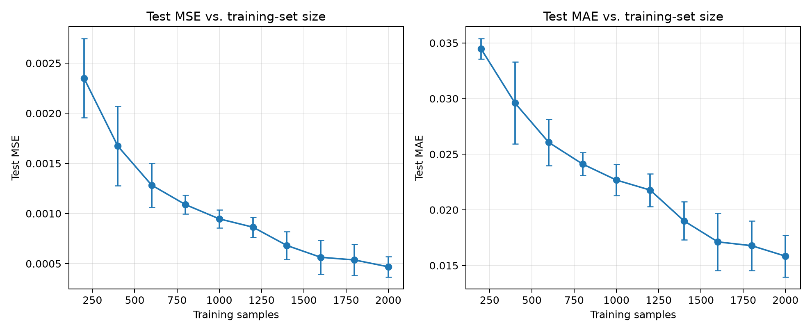
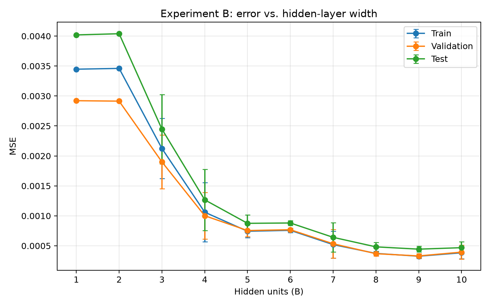
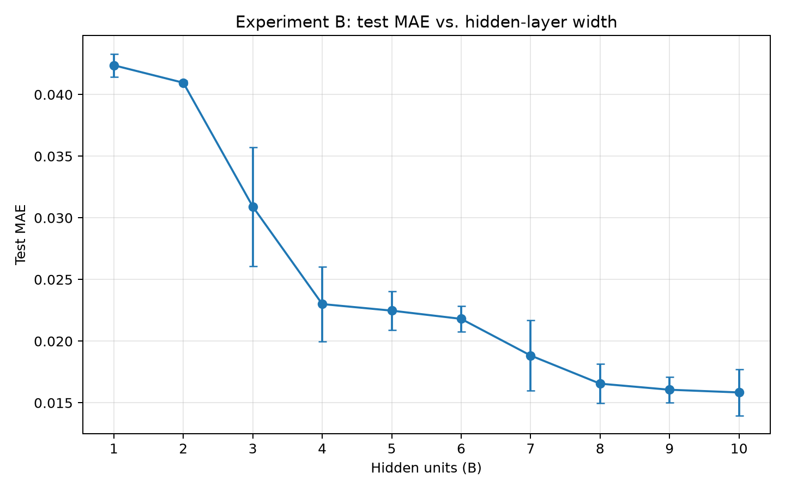

# Experiments A and B: results and discussion

## Protocol

Both experiments use a one-hidden-layer tanh MLP, input scaling
`(x1 / 2, x2 / 4)`, Adam with learning rate `0.001`, batch size `64`, at most
`500` epochs, and early-stopping patience `40`. Each setting is repeated with
seeds `42`, `43`, and `44`; the data splits remain fixed while model
initialization and training minibatch order vary. The reported `±` values are
sample standard deviations across these three runs. Training time measures the
training loop only on CPU.

Each checkpoint is selected by its lowest validation MSE. Test data is
evaluated only after that checkpoint is restored; test scores are reported for
comparison, not used to select a configuration. The tables and plots are
generated from the per-run records in `A/runs.csv` and `B/runs.csv`.

## Experiment A: training-set size

The hidden layer is fixed at 10 neurons. The same training CSV prefixes are
used at each size, and validation/test data are unchanged.

| Training samples | Validation MSE (mean ± SD) | Test MSE (mean ± SD) | Test MAE (mean ± SD) | Training seconds (mean) |
|---:|---:|---:|---:|---:|
| 200 | 0.001635 ± 0.000302 | 0.002350 ± 0.000394 | 0.03446 ± 0.00092 | 2.81 |
| 400 | 0.001176 ± 0.000230 | 0.001673 ± 0.000397 | 0.02960 ± 0.00369 | 3.80 |
| 600 | 0.000961 ± 0.000094 | 0.001284 ± 0.000221 | 0.02606 ± 0.00207 | 5.45 |
| 800 | 0.000856 ± 0.000061 | 0.001089 ± 0.000095 | 0.02412 ± 0.00103 | 6.07 |
| 1,000 | 0.000775 ± 0.000079 | 0.000947 ± 0.000089 | 0.02268 ± 0.00140 | 7.23 |
| 1,200 | 0.000719 ± 0.000107 | 0.000864 ± 0.000100 | 0.02178 ± 0.00147 | 8.06 |
| 1,400 | 0.000556 ± 0.000158 | 0.000681 ± 0.000139 | 0.01901 ± 0.00172 | 9.35 |
| 1,600 | 0.000477 ± 0.000176 | 0.000564 ± 0.000169 | 0.01712 ± 0.00259 | 10.64 |
| 1,800 | 0.000454 ± 0.000160 | 0.000537 ± 0.000156 | 0.01678 ± 0.00223 | 12.62 |
| 2,000 | 0.000394 ± 0.000114 | 0.000469 ± 0.000101 | 0.01584 ± 0.00187 | 14.83 |

Test MSE and MAE decrease at every evaluated increase in training-set size.
From 200 to 2,000 samples, mean test MSE falls by about 80% and mean test MAE
by about 54%, while average training time rises from about 2.8 to 14.8 seconds.
This is consistent with the fixed-width network benefiting from more examples;
the error bars also show that seed-to-seed variation is noticeable at some
sizes. The lowest mean validation MSE occurs at 2,000 samples, so the
validation-based comparison supports using the largest evaluated training set.



## Experiment B: hidden-layer width

The full 2,000-row training set is fixed; only the number of neurons in its
single hidden layer changes.

| Hidden neurons | Train MSE (mean ± SD) | Validation MSE (mean ± SD) | Test MSE (mean ± SD) | Test MAE (mean ± SD) | Training seconds (mean) |
|---:|---:|---:|---:|---:|---:|
| 1 | 0.003447 ± 0.000007 | 0.002921 ± 0.000006 | 0.004019 ± 0.000012 | 0.04237 ± 0.00093 | 4.21 |
| 2 | 0.003461 ± 0.000002 | 0.002914 ± 0.000000 | 0.004039 ± 0.000003 | 0.04096 ± 0.00015 | 7.54 |
| 3 | 0.002124 ± 0.000503 | 0.001900 ± 0.000450 | 0.002447 ± 0.000578 | 0.03091 ± 0.00482 | 13.70 |
| 4 | 0.001060 ± 0.000493 | 0.001002 ± 0.000389 | 0.001267 ± 0.000512 | 0.02301 ± 0.00303 | 14.64 |
| 5 | 0.000743 ± 0.000107 | 0.000754 ± 0.000100 | 0.000875 ± 0.000143 | 0.02247 ± 0.00156 | 15.32 |
| 6 | 0.000758 ± 0.000036 | 0.000768 ± 0.000026 | 0.000881 ± 0.000041 | 0.02181 ± 0.00105 | 14.14 |
| 7 | 0.000520 ± 0.000223 | 0.000534 ± 0.000237 | 0.000641 ± 0.000246 | 0.01883 ± 0.00284 | 12.71 |
| 8 | 0.000373 ± 0.000037 | 0.000368 ± 0.000041 | 0.000482 ± 0.000072 | 0.01655 ± 0.00160 | 12.44 |
| 9 | 0.000326 ± 0.000036 | 0.000331 ± 0.000039 | 0.000444 ± 0.000047 | 0.01606 ± 0.00104 | 25.00 |
| 10 | 0.000384 ± 0.000101 | 0.000394 ± 0.000114 | 0.000469 ± 0.000101 | 0.01584 ± 0.00187 | 22.91 |

Widths 1–2 have much larger train, validation, and test errors, consistent with
underfitting. Errors improve substantially as width increases through 9. The
mean validation MSE is lowest at width 9; width 10 does not improve it. Train
and validation errors remain close across the sweep, so these runs do not show
strong evidence of overfitting. The small MSE difference between widths 9 and
10 is comparable to the run variation, and the test MAE is marginally lower at
10; neither test result should be used to select the model. Select width using
validation results, and describe this small-width-end difference as uncertain
rather than a demonstrated overfitting effect.

Mean training time is higher at widths 9–10 in this CPU run, but timing varies
by seed and execution load. Treat it as an observed cost, not a hardware-
independent performance guarantee.





## Limitations

Only three initialization/shuffle seeds and one fixed 100-sample test set were
used, so the standard deviations do not capture variation from independently
resampling the data or uncertainty in the test population. Also, many runs
reached the 500-epoch ceiling with their best validation checkpoint near the
last epoch; longer training may change some comparisons. The results describe
this dataset, architecture, and training configuration, not a universal
optimal width or sample requirement.

## Reproducibility and artifacts

From the project directory, rerun the sweeps with:

```powershell
python run_experiments_ab.py --experiments A B --seeds 42 43 44
```

Each run directory stores its exact configuration and metrics, epoch-level
losses, and validation-selected weights. `summary.csv` files contain
cross-seed means and sample standard deviations; the `runs.csv` files retain
individual results for auditing.
